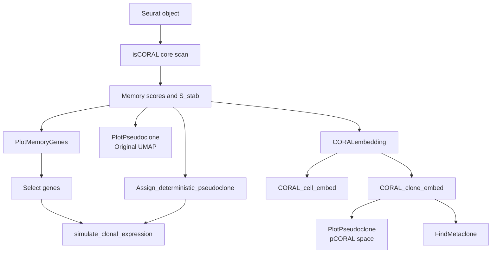

# isCORAL beta v1.0.0


## Development and Feedback
We are working to improve isCORAL and add new functions. Thus, your feedback and suggestions are very welcome. If you need a new specific function or find something not working, just let us know and we'll fix it.

Contact: Yongjie Lin (linyjie@pku.edu.cn)


## Overview

isCORAL (beta v1.0.0) is an R workflow for virtual lineage tracing from single-time-point single-cell RNA-seq data. It infers probabilistic pseudoclone relationships between cells, estimates gene-level transcriptional memory scores, constructs downstream pCORAL cell and pseudoclone embeddings, and supports Metaclone analysis in pCORAL space.

**Pseudoclone**

> A pseudoclone assigns each cell a probability distribution describing the transcriptomic regions where its clonal sisters are most likely to reside, capturing lineage uncertainty when experimental clonal labels are unavailable.

**Transcriptional Memory (Heritability) Score**

> The transcriptional memory score measures a gene's ability to maintain clonal heterogeneity across clones based on between-clone variation. isCORAL defines this score using the ANOVA omega-squared ($\omega^2$) statistic and estimates it de novo from transcriptomic data.

**Pseudoclone Embedding**

> Pseudoclone embedding integrates clone-associated information into cell representations to better separate cells with distinct clonal properties. isCORAL constructs the pCORAL embedding directly from inferred pseudoclones.

## Key Features

- **Transcriptional memory scoring** — Computes gene-wise transcriptional memory statistics via repeated NMF feature evaluation and spectral clustering.

- **Consensus pseudoclone inference** — Constructs a robust probabilistic cell co-association matrix (`S_stab`) as the pseudoclone representation.

- **Deterministic pseudoclones and expression visualization** — `Assign_deterministic_pseudoclone()` derives hierarchical cluster assignments from `1 - S_stab`; `simulate_clonal_expression()` visualizes gene expression across the original UMAP and inferred pseudoclones.

- **pCORAL embedding** — Combines energy distance, classical MDS, and multi-response Elastic Net to generate cell and pseudoclone embeddings.

- **Metaclone analysis** — Identifies clonal communities in `CORAL_clone_embed` using Leiden or Louvain clustering.

- **Seurat compatibility and provenance** — Supports Seurat v4/v5 layer/slot access with comprehensive parameter logging in `@misc`.

## Workflow



The memory scores and `S_stab` matrix from the core scan support two downstream paths:

1. **Direct feature and pseudoclone visualization**: Select top memory genes via `PlotMemoryGenes()` and pair them with deterministic groups from `Assign_deterministic_pseudoclone()` in `simulate_clonal_expression()`, or directly map seed-cell enrichment fields from `S_stab` using `PlotPseudoclone()`.

2. **pCORAL embedding and community detection**: Generate `CORAL_cell_embed` and `CORAL_clone_embed` via `CORALembedding()` for pCORAL-space visualization and `FindMetaclone()` clustering.

## System requirements

The core scan relies on `callr` and the fork-based `doMC` parallel backend, supporting Linux, macOS, and Unix-like HPC environments. Native Windows execution is not currently supported.

## Installation

```r
install.packages("remotes")
remotes::install_github("YongjieLin1998/isCORAL_beta")

library(isCORAL)
```

## Input requirements

The input must be a Seurat object with unique cell names. `isCORAL()` supports two input modes:

| Mode | Required input | Normalization behavior |
| --- | --- | --- |
| `raw_counts` (default) | Raw `counts` in the selected assay | Optional UMI downsampling (`downsampleUMI`) followed by `Seurat::NormalizeData()` |
| `pre_normalized_data` | Log-normalized matrix in `pre_normalized_layer` | Uses the supplied matrix directly; a non-`NULL` `downsampleUMI` value is ignored with a warning |

- Use `input_mode = "pre_normalized_data"` when working with objects that only provide a log-normalized `data` layer. 
- isCORAL does not automatically verify that an externally supplied pre-normalized matrix uses the expected log transformation.
- Set `species` explicitly to `"human"` or `"mouse"` to configure mitochondrial and cell-cycle gene filtering.

## Primary API

| Function | Purpose |
| --- | --- |
| `isCORAL()` | Run memory-gene estimation and consensus pseudoclone inference |
| `PlotMemoryGenes()` | Filter, rank, and visualize memory genes |
| `calculate_heritable_genes()` | Compute ground-truth gene-wise $\omega^2$ and a permutation null from experimental barcodes |
| `CompareMemoryScores()` | Benchmark inferred memory scores against experimental ground truth |
| `Assign_deterministic_pseudoclone()` | Generate deterministic hierarchical pseudoclone assignments from `S_stab` |
| `simulate_clonal_expression()` | Visualize observed expression of selected genes on the original UMAP and across deterministic pseudoclones |
| `PlotPseudoclone()` | Visualize one- or two-seed pseudoclone enrichment fields on UMAP or in pCORAL space |
| `CORALembedding()` | Construct pCORAL cell and pseudoclone embeddings |
| `FindMetaclone()` | Detect Metaclone communities in `CORAL_clone_embed` |
| `SmoothEmbedding()` | Interpolate between cell and fully diffused embeddings |

## Quick Start

### 1. Run the Core Scan

The example below runs the core scan using the default `raw_counts` mode:

```r
library(isCORAL)

bin_size <- 200L
binsize_key <- paste0("binsize_", bin_size)

set.seed(20251009)

seurat_obj <- isCORAL(
  seurat_obj = seurat_obj,
  assay = "RNA",
  input_mode = "raw_counts",
  species = "mouse",             # Use "human" for human data
  random_seed = 20251009,
  results_dir = "iscoral_results",
  downsampleUMI = NULL,
  bin_size = bin_size,
  n_repeats = 100,  # The n repeat determines the significant digits of pseudoclone distribution. 
  parallel_cores = 8,            # Match allocated CPU cores
  max_cells = NULL,
  downsample_gemli_ratio = 1,
  nmf_eval_downsample_cells = NULL
)
```

When at least two valid repeats are available, scan results are stored in `seurat_obj@misc$CORAL_scan_results[[binsize_key]]`; progress logs are written to `results_dir/logs`.

### 2. Visualize Top Memory Genes

`PlotMemoryGenes()` filters genes by mean expression (`min_mean = 0.1`) and ranks them by memory score. Set `return_data = TRUE` to retrieve the full filtered gene table alongside the plot (`top_n` controls only the number of plotted genes).

```r
memory_gene_result <- PlotMemoryGenes(
  seurat_obj = seurat_obj,
  binsize_key = binsize_key,
  min_mean = 0.1,
  top_n = 30,
  return_data = TRUE
)

memory_gene_table <- memory_gene_result$memory_genes
p_memory_genes <- memory_gene_result$plot

print(p_memory_genes)
```

### 3. Benchmark Against Experimental Barcodes (Optional)

If your dataset includes experimental lineage barcodes (e.g., stored in the `barcode` metadata column), you can compute ground-truth $\omega^2$ values via `calculate_heritable_genes()` and evaluate isCORAL's memory scores using `CompareMemoryScores()`.

```r
stopifnot("barcode" %in% colnames(seurat_obj[[]]))

Seurat::DefaultAssay(seurat_obj) <- "RNA"
set.seed(20251009)

seurat_obj <- calculate_heritable_genes(
  seurat_obj = seurat_obj,
  group_by = "barcode",
  invalid_barcodes = c(
    "0", "NA", "NaN", "", "None", "Unknown", "unknown", "Unassigned"
  ),
  min_cells_per_group = 2,
  permutation_repeats = 100,
  n_cores = 8,
  chunk_size = 2000
)
```

Then use the public API to perform the memory-score benchmark comparison:

```r
memory_comparison <- CompareMemoryScores(
  seurat_obj = seurat_obj,
  binsize_key = binsize_key,
  assay = "RNA",
  min_mean = 0.1,
  top_n = 2000
)

memory_comparison$summary
head(memory_comparison$comparison)
```

- `CompareMemoryScores()` defines the top `top_n` (2,000) genes by experimental $\omega^2$ as the positive set, returning a gene-level `comparison` table, ROC/PR curves, and a `summary` table of benchmark metrics (AUROC, AUPRC, AUPRC enrichment, Max F1, Spearman/Pearson correlations, and RMSE).

### 4. Deterministic Pseudoclones & Clonal Expression

Generate hierarchical pseudoclone assignments from `S_stab` using `Assign_deterministic_pseudoclone()` (saved to metadata as `pseudoclone_k<k>_bs<bin_size>`), then use `simulate_clonal_expression()` to view observed gene expression across the original UMAP and the top inferred pseudoclones:

```r
seurat_obj <- Assign_deterministic_pseudoclone(
  seurat_obj = seurat_obj,
  bin_size = bin_size,
  k_values = 10,
  hclust_method = "ward.D2"
)

deterministic_group <- paste0("pseudoclone_k10_bs", bin_size)
features_to_plot <- utils::head(memory_gene_table$name, 2)

clonal_expression_result <- simulate_clonal_expression(
  seurat_obj = seurat_obj,
  features = features_to_plot,
  group_by = deterministic_group,
  assay = "RNA",
  layer = "data",
  reduction = "umap",
  min_cells = 2,
  n_pseudoclones = 12,
  return_data = TRUE
)

p_clonal_expression <- clonal_expression_result$plot
pseudoclone_expression_table <- clonal_expression_result$pseudoclone_summary

print(p_clonal_expression)
```

By default, `simulate_clonal_expression()` selects the `n_pseudoclones` (12) largest pseudoclones containing at least `min_cells` cells, ordering them by mean expression for each gene.

### 5. Visualize Pseudoclone Enrichment on Original UMAP

```r
seed_cell <- colnames(seurat_obj)[1]  # Replace with a biologically relevant cell ID

p_pseudoclone_umap <- PlotPseudoclone(
  seurat_obj = seurat_obj,
  seed_cell = seed_cell,
  binsize_key = binsize_key,
  reduction = "umap",
  show_ground_truth = FALSE
)

print(p_pseudoclone_umap)
```

`PlotPseudoclone()` accepts one or two seed cells (randomly sampling one if omitted). It plots enrichment derived from row-normalized probabilities: for seed cell $s$ and target cell $j$, $\text{Enrichment}(s, j) = P_{\text{norm}}(s, j) \times (N - 1)$.

### 6. Build pCORAL Embeddings

```r
Seurat::DefaultAssay(seurat_obj) <- "RNA"

seurat_obj <- CORALembedding(
  seurat_obj = seurat_obj,
  binsize_key = binsize_key,
  n_dims = 30,
  top_n_genes = 3000,
  max_cells_lasso = NULL,
  alpha_elasticnet = 0.05,
  workers_glmnet = 5,
  random_seed = 20251009
)
```

`CORALembedding()` reads log-normalized expression data from `RNA/data` to construct low-dimensional cell and pseudoclone embeddings (if the core scan used another assay, ensure that `RNA/data` contains the matching expression matrix and gene set).

This step populates the Seurat object with:

- `CORAL_cell_embed`: expression-projected cell coordinates;
- `CORAL_clone_embed`: pseudoclone-probability-weighted coordinates;
- `seurat_obj@misc$isCORAL_embedding`: model artifacts, probability matrices, and parameter provenance.

### 7. Visualize Pseudoclones in pCORAL Space

```r
p_pseudoclone_pcoral <- PlotPseudoclone(
  seurat_obj = seurat_obj,
  seed_cell = seed_cell,
  binsize_key = binsize_key,
  reduction = "CORAL_clone_embed",
  show_ground_truth = FALSE
)

print(p_pseudoclone_pcoral)
```

Reusing the same `seed_cell` in `CORAL_clone_embed` space allows a direct visual comparison between the standard transcriptomic UMAP and the lineage-informed pCORAL representation.

### 8. Detect Metaclones

```r
metaclone_dims <- seq_len(
  ncol(Seurat::Embeddings(seurat_obj, "CORAL_clone_embed"))
)

seurat_obj <- FindMetaclone(
  seurat_obj = seurat_obj,
  resolution = 0.7,
  reduction = "CORAL_clone_embed",
  dims = metaclone_dims,
  graph_prefix = "pcoral",
  cluster_col_name = "metaclone",
  algorithm = 4,               # 4 = Leiden, 1 = Louvain
  random_seed = 42,
  verbose = TRUE
)

table(seurat_obj$metaclone)
```

Adjust `resolution` to tune community granularity for your dataset.

To use Leiden (`algorithm = 4`), first run `install.packages("leidenbase")`. `FindMetaclone()` never installs software from the network at runtime; when `leidenbase` is unavailable, or the installed Seurat version does not support its Leiden implementation, the function warns and falls back to Louvain (`algorithm = 1`). Leiden and Louvain results should not be assumed to be numerically equivalent.

## Reproducibility

- **Seed management**: Explicitly set `random_seed` in `isCORAL()`, `CORALembedding()`, and `FindMetaclone()`. When using `max_cells` or `downsampleUMI`, also call `set.seed()` in the global environment prior to running `isCORAL()`.
- **Archiving**: Save the final Seurat object (which retains parameter provenance in `@misc`), progress logs, and session information.

```r
saveRDS(seurat_obj, "sample_isCORAL_beta_1.0.0.rds")

writeLines(
  capture.output(sessionInfo()),
  "sample_isCORAL_beta_1.0.0_sessionInfo.txt"
)
```

## Questions and Issues

Please report bugs or questions via GitHub Issues.

## Citation

## Development Tools
This project leverages modern development tools to ensure code quality and efficiency. While developers write the initial code implementations, Generative AI and automated harnesses are used as assistants for tasks including:

* **Code Completion & Expansion:** Fleshing out human-written code prototypes, adding boilerplate, and completing edge-case handling.
* **Code Formatting & Refinement:** Ensuring a consistent style and clean structure across the codebase.
* **Comment Generation:** Improving code readability and inline documentation.
* **Proofreading:** Refining documentation and text within the project.

All conceptual ideation, architectural decisions, and foundational code implementations are entirely developer-authored and reviewed.
